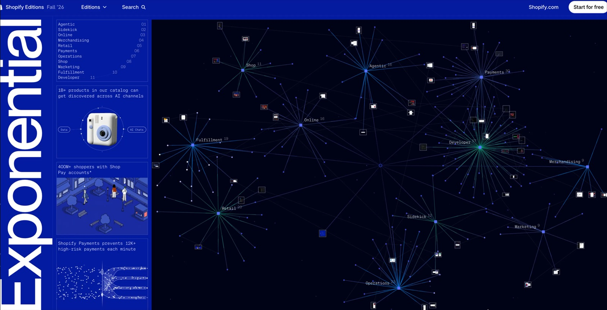
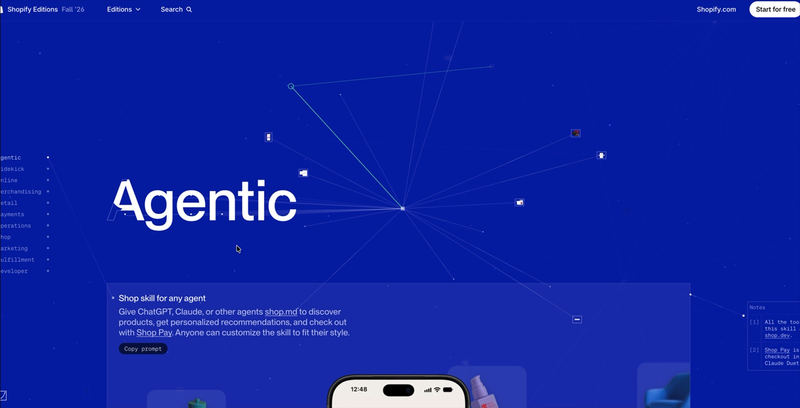
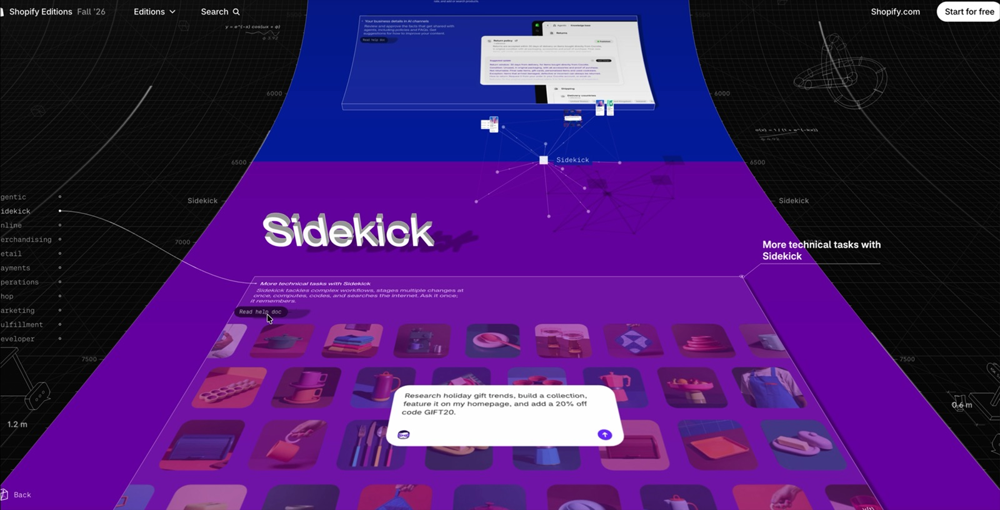
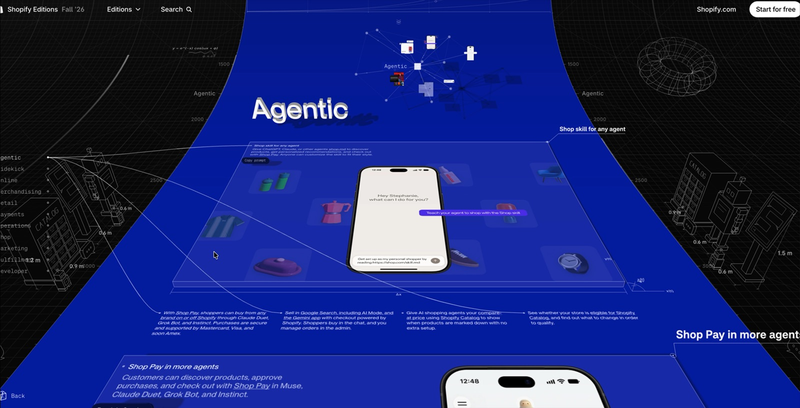
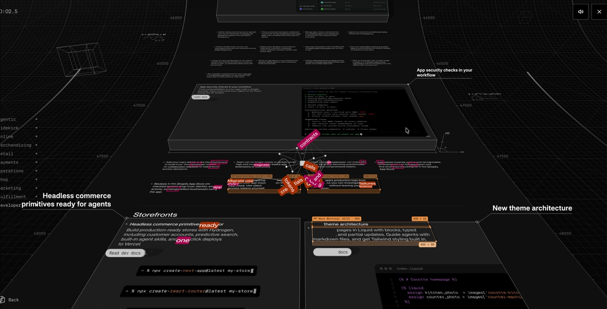

# 레퍼런스: Shopify Editions Fall '26

- URL: https://www.shopify.com/editions/fall2026
- 원본 녹화: `~/Desktop/화면 기록 2026-10-29 오후 4.50.39.mov` (61.8초, 3376×1724)
- 분석일: 2026-10-29. 영상은 1초 간격, 전환 구간은 0.3초 간격으로 프레임을 뽑아 봤다. 번들은 같은 날 받은 JS 청크 145개를 기준으로 했다.
- 아래 이미지는 내부 연구용이다. 리포를 공개하기 전에 지운다.

## 영상 흐름

| 구간 | 장면 | 프레임 |
|---|---|---|
| 0–5초 | **히어로 그래프.** 남색 공간에 허브 11개(Agentic 01 … Developer 11)가 있고 허브마다 하위 개수가 붙어 있다. 잎 노드 일부는 제품 스크린샷 썸네일이다. 왼쪽에 세로 대형 타이포 "Exponential", 목차, 통계 카드가 있다. 클릭하면 카메라가 그래프 속으로 다이브한다. |  |
| 5–7초 | **섹션 진입.** 배경이 섹션 색으로 바뀌고 해당 허브의 하위 그래프로 카메라가 이동하면서 제목이 등장한다. 목차는 왼쪽 세로 점 내비게이션으로 줄어든다. |  |
| 7–19초 | **평면 읽기.** 기능 카드, 목업, 4열 불릿이 있고 오른쪽 여백에 `Notes [1][2]` 각주가 지시선으로 연결된다. 섹션마다 고유 색이 있다. 섹션 사이 틈으로 다음 허브 그래프가 비치고, 제목이 윤곽선에서 채움으로 바뀐다. | |
| 20–48초 | **3D 모드.** 왼쪽 아래 큐브 버튼을 누르면 약 0.6초 만에 살아 있는 페이지 전체가 뒤로 눕고 휘어 공간 속 리본이 된다. 카드는 두께와 그림자가 있는 판, 섹션 제목은 압출된 3D 글자가 된다. 양옆에 스크롤 픽셀 좌표 눈금(1500…48000)이 생기고, 카드 제목은 지시선 콜아웃으로 여백에 붙는다. 배경에는 와이어프레임 건물·토러스, 치수(1.2 m), 수식(`y=e^(−x)cos(ωx+φ)`, `σ(x)=1/(1+e^(−kx))`, 푸리에 급수)이 있다. 이 상태로도 스크롤과 클릭이 계속된다. |   |
| 48–55초 | **게임.** 페이지 끝 HUD에 `hop: space / steer: ←→ AD / faster: scroll up / start / brake / v ≥ 350 px/s / to the finish 48,191 px`가 있다. 시작하면 그래프 노드가 차량이 되어 페이지를 역주행하고, 부딪힌 단어가 떨어져 나가면서 폰트 메트릭 오버레이(`PP Neue Montreal 18/22 · 500`, `400 × 22`)가 보인다. |  |

## 기술: 번들에서 확인한 사실

| 항목 | 결과 | 근거 |
|---|---|---|
| Three.js | **사용 안 함** | `REVISION`, `WebGLRenderer`, `WebGPURenderer` 0건 |
| WebGPU | **직접 사용** | `htmlInCanvasWebGpu.client-*.js`(297KB) 안에 자체 렌더러와 WGSL이 있다. `surface-*.js`, `controller-*.js`에도 `navigator.gpu`가 있다. |
| html-in-canvas | **사용** | `layoutsubtree`, `drawElementImage`, `requestPaint`, `texElementImage2D`, `GPUQueue.copyElementImageToTexture` |
| 기능 감지 | 아래 조건을 모두 만족할 때만 3D 버튼 노출 | `htmlInCanvasSupport-*.js` |
| 앱 프레임워크 | Remix/Hydrogen (React), Shopify Oxygen 호스팅 | `entry.browser-*.js`, `cdn.shopify.com/oxygen-v2/` |
| 그 밖 | 섹션 위젯을 각각 별도 청크로 지연 로드(`PaymentsGlobeWidget` 등), Rive 애니메이션, 부드러운 스크롤, 자체 그래프(`HeroGraph`, `GraphLabels`, `validateGraph`, d3 없음) | 청크 이름 |

기능 감지 코드 원문:

```js
function e(){return"requestPaint"in HTMLCanvasElement.prototype&&WebGL2RenderingContext.prototype.texElementImage2D?.length!==6&&"gpu"in navigator&&typeof GPUQueue<"u"&&("drawElementImageToTexture"in GPUQueue.prototype||"copyElementImageToTexture"in GPUQueue.prototype)}
```

메서드 이름 두 가지를 모두 검사하고 특정 시그니처(인자 6개)를 배제한다. API가 아직 바뀌고 있다는 증거다.

WGSL 진입점(`htmlInCanvasWebGpu.client`):

```
vertex:   backVertex casterVertex castTopVertex castVertex castWallVertex lineVertex
          meshVertex pointVertex shadowPointVertex textVertex topVertex wallVertex wideVertex vertexMain×3
fragment: backFragment castFragment lineFragment meshFragment pointFragment
          shadowLineFragment shadowPointFragment textFragment topFragment wallFragment fragmentMain×3
```

이름으로 해석하면 다음과 같다. `top`/`wall`은 판의 윗면(DOM 텍스처)과 옆면, `cast*`/`shadow*`는 투영 그림자, `line`/`point`/`wide`는 그래프·와이어프레임·굵은 선, `text`는 압출 글자나 라벨, `mesh`는 3D 오브젝트, `back`은 배경이다. 코드에 `bend`가 17건 있어 페이지를 휘는 처리로 보인다.

## 가져올 것 / 가져오지 않을 것

| 가져올 것 (기법·구조) | 가져오지 않을 것 (정체성) |
|---|---|
| 그래프가 사이트의 뼈대이자 내비게이션 | 섹션별 원색 배경 팔레트 |
| 평면 ↔ 공간 왕복, 공간에서도 상호작용 유지 | 타이포그래피, 레이아웃, 카피 |
| 여백 각주 + 지시선 → 학술 각주 | 게임 메커닉 그대로 |
| 도면 미학(격자·치수·수식) → "설계 공간" | |
| 지원 감지 후에만 켜는 점진적 향상 | |
| 섹션 위젯 개별 지연 로드 | |
